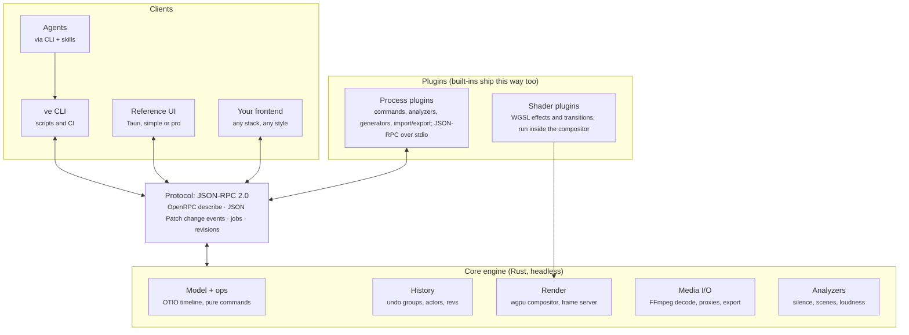

# Headless Video Engine — Architecture

Oct 20, 2026 · Gershon Binder · Live doc: https://claude.ai/artifact/2wLqcMJu4wNw995uEt4exS

## Overview and goals

Build a headless, agent-friendly video editing engine in Rust. The engine is the product; every UI, agent, script and plugin is a client of the same protocol.

**Goals**

- **Headless first.** Every capability is reachable without a UI. A UI never gets a private API.
- **Agents as first-class users.** An LLM can inspect footage, edit the timeline, check its work and render, through a CLI plus skills. No MCP required.
- **Standards over invention.** OTIO for the project, JSON-RPC 2.0 + OpenRPC for the protocol, JSON Schema for parameters, JSON Patch for change events, WGSL for effects, SKILL.md for agent docs.
- **Extensible by anyone.** Effects, transitions, commands, analyzers, importers and exporters are plugins. Built-in features ship as plugins too.
- **Bring your own frontend.** The protocol is small and self-describing, so a person (or an LLM reading `editor describe`) can build a simple UI, a pro UI, or an AI-native one.
- **AI-neutral core.** No model inside the core. AI arrives as a driving client or as plugins.

**Primary use case:** editing real footage (talking heads, podcasts, phone clips, screen recordings) with an agent alongside the user. Generated motion graphics are secondary and can come from tools like HyperFrames rendered as overlay clips.

**Non-goals for v1:** mobile apps, cloud sync, a template marketplace, real-time multi-user collaboration.

## System layers



Clients sit above one protocol; the core and plugins sit below it. Agents drive the engine through the CLI. Shader plugins run inside the compositor; process plugins call back through the protocol like any client.

**Two run modes, one code path**

- **Direct mode:** with no daemon running, each CLI call opens the project folder under a file lock, applies the command, saves and exits. Good for scripts, CI and one-shot agent tasks.
- **Session mode:** `ve daemon start` keeps the project in memory, owns the frame cache and decoders, and streams change events. The CLI detects the daemon and routes calls to it, so a UI watching the session sees agent edits land live.

Both modes run the same command functions from `ve-ops`; the daemon only adds caching, jobs and the event stream.

## Project format

The project file is an OpenTimelineIO (OTIO) JSON document. Anything OTIO cannot express lives in OTIO `metadata` under one namespaced key, so other OTIO tools read the edit and ignore our extensions.

**Rules**

- **Time is always `RationalTime`** (`value` + `rate`). No floats anywhere in the model or the protocol. UIs display SMPTE timecode.
- **Stable IDs.** Every track, clip, effect, keyframe and marker gets a short ID (e.g. `clip_7f3a`) stored in metadata. Commands address IDs, never indexes.
- **Media by reference.** Source files are `ExternalReference`s. Proxies, analysis output and AI-baked assets are tracked in an asset table with hashes.
- **Revision counter** on the document, incremented by every committed command.
- **Schema version** in metadata, with migrations from day one.

**Extension namespace (`ve` used as a placeholder name)**

| Where | Key | Holds |
| --- | --- | --- |
| Timeline | `metadata.ve.project` | schema version, revision, output settings (resolution, fps, sample rate, color space) |
| Timeline | `metadata.ve.assets` | asset table: id, path, hash, kind (source, proxy, analysis, baked), provenance |
| Clip | `metadata.ve.clip` | stable id, speed, volume, transform, effect stack |
| Clip effect | `metadata.ve.effects[]` | id, plugin effect id, params, keyframes |
| Transition | `metadata.ve.transition` | plugin transition id, params |
| Marker | `metadata.ve.marker` | stable id, source (user, agent, analyzer), payload |

**Example clip**

```json
{
  "OTIO_SCHEMA": "Clip.2",
  "name": "intro_take3",
  "source_range": {
    "OTIO_SCHEMA": "TimeRange.1",
    "start_time": { "OTIO_SCHEMA": "RationalTime.1", "value": 312, "rate": 30 },
    "duration":   { "OTIO_SCHEMA": "RationalTime.1", "value": 450, "rate": 30 }
  },
  "media_references": {
    "DEFAULT_MEDIA": { "OTIO_SCHEMA": "ExternalReference.1", "target_url": "media/IMG_4410.MOV" }
  },
  "metadata": {
    "ve": {
      "clip": { "id": "clip_7f3a", "speed": [1, 1], "volume_db": 0 },
      "effects": [
        {
          "id": "fx_02",
          "effect": "core.color/exposure@1",
          "params": { "exposure": 0.3 },
          "keyframes": { "exposure": [
            { "t": { "value": 0, "rate": 30 }, "v": 0.0, "ease": "linear" },
            { "t": { "value": 30, "rate": 30 }, "v": 0.3, "ease": "ease-out" }
          ] }
        }
      ]
    }
  }
}
```

Keyframe times are relative to the clip's start on the timeline. Speed is a rational (`[num, den]`) for the same reason time is.

## Protocol

One protocol for every client: JSON-RPC 2.0 over a local socket (Unix socket, Windows named pipe) and optionally WebSocket. Commands change the project; queries read it; notifications stream changes out.

**Method families**

| Family | Examples | Notes |
| --- | --- | --- |
| `project.*` | `open`, `save`, `get`, `summary` | `summary` returns compact text for agents, not the full JSON |
| `media.*` | `import`, `probe`, `assets` | probe returns ffprobe-shaped JSON |
| `edit.*` | `insert`, `split`, `trim`, `move`, `ripple_delete`, `set_speed` | all mutate; all take `base_rev` |
| `fx.*` | `add`, `set_param`, `set_keyframe`, `remove`, `add_transition` | params validated against the effect's JSON Schema |
| `render.*` | `frame`, `range_preview`, `export` | `frame` and `range_preview` are the agent's eyes |
| `analyze.*` | `silence`, `scenes`, `loudness` | built-in analyzers; plugins add more |
| `history.*` | `undo`, `redo`, `list`, `begin_group`, `end_group` | groups collapse one agent action into one undo step |
| `jobs.*` | `list`, `get`, `cancel` | long-running work |
| `system.*` | `describe`, `plugins`, `version` | `describe` returns the OpenRPC document |

**Self-description.** `system.describe` returns an OpenRPC document generated from the Rust code: every method, its params as JSON Schema, every installed plugin's effects and commands, and every event type. This is the contract agents and frontend builders read. It cannot drift because it is generated.

**Revisions and conflicts.** Every mutating call carries `base_rev`. If the project has moved on, the call fails with `stale_revision` and the current rev; the client re-reads and retries. Single writer, optimistic concurrency. No CRDTs.

**Actors.** Every call carries `actor`: `{ "kind": "user" | "agent" | "plugin", "id": "..." }`. History records it, so a UI can show and undo "the agent's last 12 edits" as one action.

**Change events.** Every committed command emits a notification:

```json
{
  "jsonrpc": "2.0",
  "method": "project.changed",
  "params": {
    "rev": 42,
    "actor": { "kind": "agent", "id": "claude" },
    "command": "edit.ripple_delete",
    "patch": [
      { "op": "remove", "path": "/tracks/children/0/children/4" },
      { "op": "replace", "path": "/metadata/ve/project/revision", "value": 42 }
    ]
  }
}
```

A frontend's whole sync story: load the document once, apply each `patch` (RFC 6902) in rev order, re-fetch if a rev is skipped. Undo is the stored inverse patch.

**Jobs.** Anything slower than ~200 ms (export, proxies, analysis, AI plugins) returns `{ "job_id": ... }` immediately and emits `job.progress` and `job.finished` notifications. Jobs are cancellable.

**Dry runs.** Every mutating method accepts `dry_run: true` and returns the patch it would apply without committing. Agents use it to preview destructive edits.

## Render pipeline

FFmpeg handles decode and encode; a wgpu compositor handles everything between. One render graph serves preview frames, range previews and final export, so they cannot disagree.

**Stages**

1. **Resolve.** For time `t`, walk the timeline and list active clips per track, their source times (after speed and trims), effects with keyframes evaluated at `t`, and any transition in progress.
2. **Decode.** Pull source frames through a decoder pool. Each source keeps a warm decoder with a GOP-aware seek (seek to the prior keyframe, decode forward). Proxies are used when the request is low-res.
3. **Upload.** Frames go to GPU textures in a linear working color space (convert from Rec.709/sRGB on the way in).
4. **Composite.** Per track: apply the clip's effect stack (shader passes), then the transform; blend tracks bottom to top; apply transitions where two clips overlap.
5. **Output.** Convert back to the output color space. Preview: read back to RGBA and encode as JPEG/PNG. Export: hand frames to the encoder.
6. **Audio.** Separate graph: decode, resample (`rubato`), apply gain and fades, mix tracks, measure loudness (`ebur128`). Export muxes audio with video; preview uses the audio clock as master.

**Frame server (what frontends and agents use)**

- `render.frame { t, width }` returns one composited frame. Target: under 150 ms at 640 px with proxies.
- `render.range_preview { in, out, width }` returns a low-res MP4 for a range. This is how an agent checks a cut.
- `render.contact_sheet { in, out, count }` returns a grid image of evenly spaced frames, the cheapest way for a model to see a range.
- **Playback stream (later, after jobs): HLS.** The daemon serves the timeline as an HLS playlist of short fMP4 segments (2 to 4 s) from its existing HTTP server, behind the same token. Browsers play it with hls.js (Safari natively), so a web frontend gets real playback with sound, and a hosted version later needs no new transport. Segments come from the same render graph as export, so playback cannot disagree with the final file. Each segment is cached by a hash of everything in its time range, so an edit re-renders only the segments it touches; the playlist is regenerated on every revision and the player reloads it. Jobs render segments ahead of the playhead. Scrubbing stays on `render.frame` (HLS is for playing, not frame-exact seeking). Generated clips with a live preview draw over the player, as described under generators. Known risks: start-up delay (one segment render, roughly 0.5 to 1.5 s), and AAC priming gaps at segment joins (render audio as one continuous stream, or use longer segments, if clicks show up). Considered and rejected for now: raw frames over WebSocket (no standard player, no audio sync for free) and MSE over WebSocket (same result as HLS with more custom code).

**Caches**

- **Proxies:** generated on import as a job (e.g. 540p, all-intra codec) so seeks are cheap.
- **Thumbnails and waveforms:** generated per asset, served to UIs as files.
- **Frame cache:** keyed by a hash of everything that affects the frame (clip, source time, effect params). A changed parameter invalidates exactly the frames it touches.

**Determinism rule.** A frame is a pure function of the project and `t`. Effects get time and params, nothing else: no wall clock, no random seeds that are not params, no state carried between frames. This is what makes any frame renderable on demand and caching safe.

**Encoding and licensing.** Ship an LGPL FFmpeg build and prefer hardware encoders (NVENC, QuickSync, AMF, VideoToolbox) plus `openh264`. Users can point the engine at their own FFmpeg if they want x264/x265. Shelling out to the `ffmpeg` binary for export is acceptable for v1; move to `ffmpeg-the-third` bindings where per-frame control is needed (preview decode).

## Effects and transitions

An effect or transition is one WGSL function plus a manifest. The contract is deliberately tiny so an agent can write a working one in a single attempt.

**Effect contract**

The engine wraps the author's function in a full shader that handles sampling, uniforms and output. The author writes only this:

```wgsl
// Inputs provided by the engine:
//   src(uv) -> vec4<f32>      sample the clip's frame (linear RGB, premultiplied alpha)
//   u.time: f32               seconds since clip start
//   u.progress: f32           0..1 across the clip
//   u.resolution: vec2<f32>   output size in pixels
//   p.<param>                 parameters from the manifest, keyframes already evaluated

fn effect(uv: vec2<f32>) -> vec4<f32> {
    let c = src(uv);
    let gray = dot(c.rgb, vec3<f32>(0.2126, 0.7152, 0.0722));
    return vec4<f32>(mix(c.rgb, vec3<f32>(gray), p.amount), c.a);
}
```

**Transition contract** (mirrors gl-transitions)

```wgsl
// from(uv), to(uv) -> vec4<f32>   outgoing and incoming frames
// u.progress: f32                 0..1 across the transition

fn transition(uv: vec2<f32>) -> vec4<f32> {
    let edge = smoothstep(p.softness * -1.0, 0.0, uv.x - u.progress * (1.0 + p.softness));
    return mix(to(uv), from(uv), edge);
}
```

**Manifest** (`effect.json`)

```json
{
  "id": "core.color/desaturate",
  "version": "1.0.0",
  "kind": "effect",
  "name": "Desaturate",
  "shader": "desaturate.wgsl",
  "params": {
    "type": "object",
    "properties": {
      "amount": { "type": "number", "minimum": 0, "maximum": 1, "default": 1, "x-animatable": true }
    }
  },
  "skill": "SKILL.md"
}
```

`params` is plain JSON Schema. `x-animatable` marks params that accept keyframes. UIs build a settings panel straight from it.

**Importing gl-transitions.** The gl-transitions library is GLSL with the same shape (`from`, `to`, `progress`, uniforms). An importer translates GLSL to WGSL with `naga` and generates the manifest from its uniform declarations, giving a large transition library on day one.

**Agent-authored effects: the safety path**

1. Agent writes `effect.json` + `.wgsl` into the project's `effects/` folder (or calls `fx.define` with the source).
2. `naga` parses and validates the WGSL against the wrapper. Errors return to the agent with line numbers so it can fix them.
3. Engine compiles the pipeline and renders a 3-frame test at low res with a timeout. A hang or a NaN-filled output fails the test.
4. On pass, the effect registers as `project.<name>` and is usable immediately. Project-local effects travel with the project file.
5. A user can promote a project effect into an installed plugin with one command.

**Out of scope for v1:** multi-pass effects (blur pyramids, temporal effects that read neighboring frames). Design the manifest so a `passes` array can be added later without breaking single-pass effects.

## Plugin system

A plugin is a folder with a `plugin.json` manifest. It can contribute any mix of the five extension types below, and built-in features ship as plugins through the same API.

| Type | Contributes | Runs as | Example |
| --- | --- | --- | --- |
| Effect / transition | WGSL shader + param schema | inside the compositor | film grain, glitch wipe |
| Command | new protocol methods (macros over `edit.*`) | external process | `jumpcut.remove_silences`, `beatsync.cut_to_beats` |
| Analyzer | markers + analysis assets | external process, as a job | transcription, face tracking, beat detection |
| Generator | new media assets, or editable generated clips (template + params) | external process, as a job | TTS voiceover, background-removal matte, HyperFrames lower third, Blender scene |
| Import / export | project format adapters | external process | FCPXML, EDL, Premiere XML via OTIO adapters |

Every plugin can also ship a `SKILL.md` that teaches agents when and how to use it.

**Manifest** (`plugin.json`)

```json
{
  "id": "community.jumpcut",
  "version": "0.3.0",
  "engine": ">=0.4 <0.6",
  "protocol": "1",
  "name": "Jump Cut Tools",
  "contributes": {
    "commands": [
      { "method": "jumpcut.remove_silences", "params": "schemas/remove_silences.json", "mutates": true }
    ],
    "effects": ["effects/punch_in.json"]
  },
  "run": { "command": "python", "args": ["main.py"] },
  "requires": { "gpu": false, "downloads": [] },
  "skill": "SKILL.md"
}
```

**Process plugins (v1).** The engine starts the plugin's process and talks JSON-RPC over stdio, the same pattern as LSP. The plugin receives the call, can call back into the engine's normal methods (`project.get`, `edit.*`, `render.frame`) as actor `plugin:<id>`, and returns a result. Any language works. An agent can write a Python plugin in one sitting. All edits a plugin makes inside one call form one undo group.

**Generated clips.** A generator can also make a clip that stays editable on the timeline: an animated lower third or title from HyperFrames, a 3D scene from Blender or three.js, an AI video shot, a caption style drawn in HTML. The clip keeps the recipe. While you edit it plays live; pixels are baked only when something needs them.

- **Recipe on the clip.** `metadata.ve.generated` holds the plugin id and version, the template and its params. Bakes are `baked` assets with provenance, cached by segment and params hash, so reopening a project never re-renders.
- **Live while editing.** A generator can ship a live preview: for HTML generators, the same page the bake renders, driven by the playhead time. A UI draws it over the player, so a changed param shows at once with no render. Generators without one (a Blender scene, an AI shot) show their last bake, or a placeholder until the first.
- **Bake only when pixels are needed.** The engine bakes through the plugin, as a job: the whole clip on export; only the frames asked for on `render.frame`, `render.contact_sheet` and `render.range_preview`, so agents and other clients see overlays too; and in the background when the daemon is idle, so export rarely waits. A param change invalidates only the segments it touches.
- **Output.** A bake is video with alpha (ProRes 4444, VP9 WebM with alpha, or a PNG sequence) at the project's size and frame rate. The compositor places it on an overlay track like any other clip.
- **Same look live and baked.** Frame N depends only on the template, the params and N: no wall clock, no randomness that is not a param, fonts and assets bundled with the template. For HTML, the UI's webview (WebView2 is Chromium) and the bake's headless Chrome are the same engine. Where they differ, the bake is the reference.
- **Plugins bring their own renderer** (headless Chrome, Blender, a model). The core never ships one, and anyone can write a different generator for the same job.
- **Needs from the core:** jobs, a compositor that stacks video tracks with alpha (also needed for text, masks and picture-in-picture), the `baked` asset kind (exists), and a small preview contract: a method that gives a UI the generator's preview page and the clip's params, which the UI then drives with the playhead time.

**Discovery.** Plugins load from three places, highest priority first: the project's `plugins/` folder, the user's plugin folder, and the built-in set. `system.plugins` lists them; `system.describe` merges their methods and schemas into the OpenRPC document.

**Versioning.** Plugins declare the engine range and protocol major version they support. The engine refuses to load mismatches with a clear error. Protocol changes follow semver: additive in minors, breaking only in a new major with a deprecation window.

**Sandboxing (later).** Process plugins run with the user's permissions, like VS Code extensions. If a public plugin registry happens, add a WASM tier (`wasmtime`, WASI) with explicit capabilities (read project, write edits, read media folder) for untrusted plugins. Shaders are already sandboxed by the GPU validation path.

**Dogfooding rule.** Silence detection, scene detection, the default transitions and the color effects ship as plugins in `plugins/core`. If the plugin API cannot express a built-in feature, fix the API, not the feature.

## AI integration

The core contains no models. AI enters at three levels, and all three use mechanisms the engine needs anyway.

| Level | What it is | Needs from the core |
| --- | --- | --- |
| Driver | An agent edits through the CLI and skills (Claude Code, Codex, Cursor, Gemini CLI) | `describe`, compact `project.summary`, frame and range previews, dry runs, undo groups |
| Capability plugin | Analyzers and generators: transcription, background removal, upscaling, denoise, auto-reframe, TTS | jobs with progress and cancel, asset table, provenance, GPU and download declarations |
| AI-native frontend | A chat-first editor that embeds a model and talks to the protocol | the same protocol any frontend uses; nothing extra |

**Perception for agents.** Agents need cheap, precise ways to see footage. Video-capable models can read frames or clips directly, but they sample sparsely and cost many tokens, so the engine provides a ladder from cheapest to richest:

1. `project.summary`: tracks, clips, durations and markers as compact text.
2. Analyzer markers: silences, scene cuts, loudness, and transcript words when a transcription plugin is installed.
3. `render.contact_sheet`: one grid image for a range.
4. `render.frame`: exact frames at the cut points.
5. `render.range_preview`: a low-res clip for models that accept video.

**Bake, don't re-run.** AI output is non-deterministic, so generators write an asset (a matte video, an audio file, an upscaled clip) and the timeline references it. Rendering stays deterministic and re-renders never call the model again.

**Provenance.** Every baked asset records plugin id and version, model name, parameters, input asset hashes and timestamp in the asset table. That supports regeneration, auditing and honest labeling of AI-generated media.

**Agent edit loop (taught by the core skill)**

1. Read `project.summary` and the relevant markers.
2. Plan the edit; for destructive edits run it with `dry_run` first.
3. Wrap the edit in `history.begin_group` / `end_group`.
4. Check cut points with `render.frame` or a contact sheet.
5. Fix, or report what changed and how to undo it.

## CLI and agent skills

The CLI is a thin client: each subcommand maps to one protocol method. If a daemon is running for the project it sends the call there; otherwise it opens the project file directly under a lock, runs the call, saves and exits.

**Conventions**

- Non-interactive by default. Never prompts; destructive commands need `--yes` or run as `--dry-run`.
- `--json` on every command for machine-readable output; human-readable text otherwise.
- Times accept timecode (`00:01:12:12`), frames (`f2172`) or seconds with a rate (`72.4s`), and are normalized to `RationalTime`.
- Exit codes: 0 ok, 2 invalid params, 3 stale revision, 4 render failure, 5 plugin error.
- `--actor` defaults to `user`; the agent skill sets `--actor agent:<name>`.

**Initial command set**

```bash
ve init my-edit --fps 30 --size 1920x1080
ve import media/*.MOV                       # probes, creates proxies as a job
ve summary                                  # compact timeline text
ve describe --json                          # OpenRPC document

ve insert asset_03 --track V1 --at 00:00:10:00
ve split clip_7f3a --at 00:01:12:12
ve trim clip_7f3a --in +15f --out -1s
ve move clip_7f3a --to 00:00:42:00 --track V2
ve ripple-delete --from 00:02:10:00 --to 00:02:14:15 --dry-run
ve speed clip_7f3a 3/2

ve fx add clip_7f3a core.color/exposure --set exposure=0.3
ve fx key fx_02 exposure --at 0f=0 --at 30f=0.3 --ease ease-out
ve fx define ./effects/grain.json           # validate + test-render + register
ve transition add clip_7f3a clip_8b21 core.wipe/soft --duration 12f

ve analyze silence --threshold -40dB --min 0.4s
ve analyze scenes
ve frame --at 00:01:12:12 --width 640 -o cut.jpg
ve sheet --from 00:01:00:00 --to 00:01:30:00 --count 12 -o sheet.jpg
ve preview --from 00:01:00:00 --to 00:01:30:00 -o check.mp4
ve export --preset youtube-1080p -o final.mp4

ve undo --group
ve history --actor agent
ve daemon start                             # live session for UIs
ve plugin list | install <path> | new <name>
```

**Skills shipped with the engine**

| Skill | Teaches |
| --- | --- |
| `video-edit` | the edit loop, time formats, IDs, undo groups, how to check cuts |
| `video-effects` | the effect and transition contracts, how to define, test and fix shaders |
| `video-plugin-dev` | scaffolding a process plugin, calling back into the engine, packaging |
| `video-frontend-dev` | building a UI on the protocol: load, subscribe to patches, frame server, `describe` |

Plugins add their own skills next to these. `ve plugin new` scaffolds one.

## Rust workspace

One Cargo workspace. The model crate has no I/O and no GPU so it stays fast to test; everything heavy sits behind it.

```text
ve/
  crates/
    ve-model/      timeline types (OTIO serde), RationalTime, IDs, validation, migrations
    ve-ops/        commands as pure functions: (doc, params) -> (new doc, patch, inverse patch)
    ve-history/    undo/redo, groups, actors
    ve-media/      probing, decode pool, proxies, thumbnails, waveforms (FFmpeg)
    ve-render/     resolver, wgpu compositor, effect wrapper, frame cache, audio graph
    ve-export/     encode + mux, presets
    ve-analyze/    silence, scenes, loudness (built-in analyzers)
    ve-plugin/     manifest parsing, discovery, process host (JSON-RPC over stdio)
    ve-protocol/   method registry, JSON Schema + OpenRPC generation, error codes
    ve-daemon/     session server: socket/pipe + WebSocket, jobs, event stream
    ve-cli/        the `ve` binary
  plugins/core/    built-in effects, transitions, analyzers as plugins
  skills/          SKILL.md files shipped with the engine
  apps/desktop/    Tauri reference UI (optional client)
```

**Key dependencies**

| Need | Crate |
| --- | --- |
| Serialization | `serde`, `serde_json` |
| JSON Schema from Rust types | `schemars` |
| JSON Patch | `json-patch` |
| Exact rational time | `num-rational` |
| Async runtime | `tokio` |
| JSON-RPC server | `jsonrpsee` |
| CLI | `clap` |
| Decode / encode | `ffmpeg-the-third` (plus `ffmpeg` binary for export in v1) |
| GPU compositing | `wgpu` |
| Shader validation, GLSL to WGSL | `naga` |
| Text rendering | `cosmic-text` + `glyphon` |
| Audio output, resampling, loudness | `cpal`, `rubato`, `ebur128` |
| Image output | `image` |
| WASM plugins (later) | `wasmtime` |

Crate maintenance status changes; check recent release dates on crates.io before locking these in, especially the FFmpeg bindings.

**Testing strategy.** `ve-ops` gets property tests (every command's inverse patch restores the original document; total duration math holds after ripple edits). `ve-render` gets golden-frame tests: render known frames from fixture projects and compare against stored images with a small tolerance.

## Build order

Phase 1's gate is the real product test: if an agent can cut a 10-minute talking-head recording end to end through the CLI, the engine works and everything after it is extension.

| Phase | Weeks (solo, rough) | Deliverables | Gate to move on |
| --- | --- | --- | --- |
| 0 · Spike | 1–2 | decode a clip with FFmpeg; composite one frame in wgpu; OTIO round-trip with serde | one frame matches FFmpeg's own render |
| **1 · Headless core** | 3–8 | model, ops, history, method registry; CLI direct mode, export, frame/sheet/preview; silence + scene analyzers, `video-edit` skill | **an agent cuts a 10-min talking head end to end via the CLI only** |
| 2 · Effects | 9–12 | effect + transition contracts, `fx define`; gl-transitions import via naga; 10+ built-in effects and transitions | an agent writes a new effect that passes validation in 2 tries |
| 3 · Plugins | 13–16 | daemon, JSON-RPC, OpenRPC describe; patch events, jobs, process plugins; `video-plugin-dev` skill | a jump-cut plugin built from describe + skill with no engine changes |
| 4 · Frontends | 17+ | minimal Tauri reference UI; live playback driven by the audio clock; `video-frontend-dev` skill | an LLM builds a working frontend from describe + skill alone |

The method registry and JSON Schema generation start in Phase 1 even though the daemon arrives in Phase 3, so the CLI is built on the protocol from the first commit. The plugin API is frozen only after Phase 2's built-in effects prove it, per the dogfooding rule.

## Open decisions and risks

**Decisions to make before Phase 1 ends**

- [ ] Product name and CLI binary name (`ve` is a placeholder; the metadata namespace follows it).
- [ ] License for the engine: permissive (MIT/Apache-2.0) for maximum adoption, or copyleft (MPL/AGPL) to keep forks open. This also decides what a commercial frontend or hosted version can look like.
- [ ] Store the project as pure OTIO JSON, or as a folder (`project.otio` + `effects/` + `plugins/` + `cache/`). The folder is likely right because project-local effects and plugins need a home.
- [ ] Whether `ve-model` reuses an existing OTIO Rust binding or implements the schema directly with `serde`. Direct `serde` structs are simpler and keep the core pure Rust.
- [ ] Target platforms for v1: Windows + macOS first, Linux close behind.

**Risks**

| Risk | Why it bites | Mitigation |
| --- | --- | --- |
| Seek performance on phone and long-GOP footage | slow frames make the agent loop and any UI feel broken | proxies on import, warm decoder pool, frame cache |
| Variable frame rate sources | iPhone and screen recordings drift out of A/V sync | normalize to constant frame rate in proxies; map source times explicitly |
| Color handling | wrong conversions give washed-out or crushed exports | one linear working space, explicit input/output transforms, golden-frame tests |
| Protocol churn | third-party frontends and plugins break | version from day one, generate OpenRPC, deprecation windows |
| Plugin API designed too early | wrong abstractions get locked in | build 10+ built-in effects and two commands before freezing the API |
| Agent-written shaders | hangs, crashes, NaNs, driver resets | naga validation, timeout test render, project-local until promoted |
| FFmpeg licensing | GPL codecs force GPL on distribution | LGPL build, hardware encoders, user-supplied FFmpeg for x264/x265 |
| Scope creep toward a full NLE | months on UI polish instead of the engine | headless milestones first; the reference UI stays minimal until Phase 4 |
